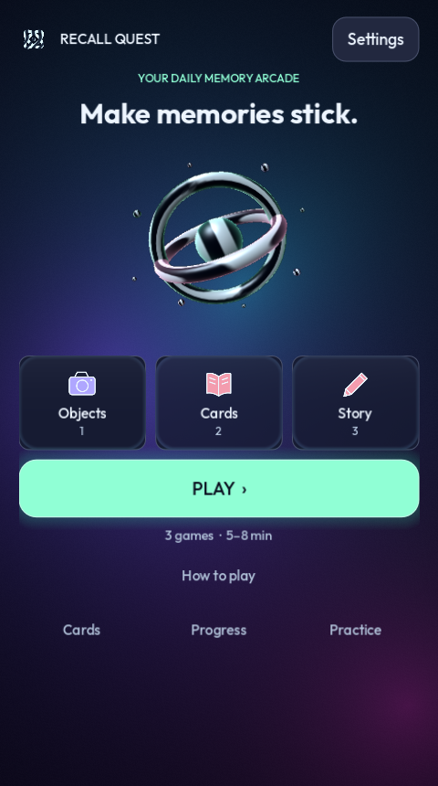
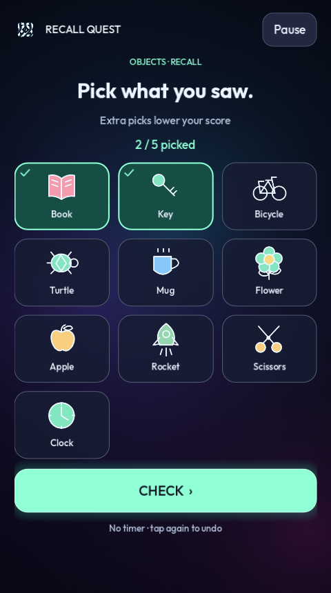

# Recall Quest

A native offline memory arcade built with Godot 4.6.3. One game project supports Windows, Android and iOS; it is not a web app or a browser wrapper.

## Run from this repository

This is the source repository for Brain Trainer / Recall Quest 1.2.0. Install Godot **4.6.3 standard edition**, import `game/project.godot`, and press **F5** to play. No browser, Node or server is needed. Native Windows and Android packages can be exported with the included presets and build instructions below. An iOS package requires macOS, Xcode and your Apple signing team.

Generated game packages, downloaded toolchains and signing keys are intentionally excluded from Git. The `builds/` paths below refer to packages generated locally. Shared gameplay passes **102 checks**; Android phone gameplay and iOS packaging remain unverified. See [verification notes](VERIFICATION.md).

| Opening screen | Object recall |
| --- | --- |
|  |  |

## Play on Windows

Extract `builds/RecallQuest-Windows.zip` and open `RecallQuest.exe`, or open the executable already in `builds/windows/`. **Keep `RecallQuest.pck` beside the executable.** This package uses the unchanged, officially signed Godot executable to run the native game data, because Windows application control blocked the locally exported unsigned runtime. Godot does not need to be installed separately to play. Choose **PLAY** or **CONTINUE**, depending on your progress. The game saves progress automatically on this computer.

## A visual arcade — version 1.2

The opening screen centres on a rotating native 3D memory core, three illustrated stages, and one **PLAY** button. The home stays within 45 words. Flowing colour, a liquid-metal emblem, refractive glass and result sparks run directly in Godot. The four requested skills informed these native effects; their browser/React libraries are not bundled. See `VISUALS.md` for exact sources.

Choose **How to play** for the untimed object example. It never changes scores, streak or daily progress. Each real game has three illustrated verbs and a **LET'S GO** button; each intro stays within 35 words. Selected objects have visible ticks. Wrong picks still reduce the score. Flashcard and story scores remain honest self-checks. The story itself stays readable; explanatory paragraphs have been removed from play.

Returning players **CONTINUE** from the first unfinished game. A finished day offers **PLAY AGAIN** for practice. **Cards**, **Progress**, and **Practice** are secondary links. Settings includes **Reduce all motion** and **Simple visuals**; the latter replaces 3D with a static SVG and removes decorative shaders. Gameplay and local saves remain the same.

Updating to this version preserves existing local progress. On Android install the new APK over the old version; do not uninstall first.

## Play on Android

Transfer `builds/android/RecallQuest.apk` to your Android phone, open the file and permit installation from the file manager if Android requests it. After installation, open **Recall Quest**. This is a sideload build signed with a development key, not a Google Play release. Both ARM64 phones and x86_64 emulators are included. APK signatures and archive alignment are checked during packaging; physical-device gameplay testing is still needed.

## iPhone / iPad status

The shared native game source and an iOS export preset are included. **There is no installable iOS build in this delivery.** Apple's build and signing steps require a Mac with Xcode and an Apple signing team. Those tools are unavailable on this Windows machine.

On a Mac:

1. Install Godot **4.6.3 standard edition** and its matching export templates, plus Xcode.
2. Extract the source archive and import `game/project.godot` into Godot.
3. Open Project → Export → iOS. Fill in your actual App Store Team ID and choose a bundle ID that belongs to you. The provided `org.recallquest.memorygame` is a development identifier, not an ownership claim.
4. Select the signing identity and provisioning profile appropriate to your own team and intended devices. Export into an empty folder.
5. Open the resulting Xcode project, select your signing team and iPhone/iPad, then build and run.
6. Test touch input, text entry with the on-screen keyboard, safe margins, pause/resume and save persistence before distributing through TestFlight or the App Store.

Godot's official iOS requirements: https://docs.godotengine.org/en/stable/tutorials/export/exporting_for_ios.html

## Three daily missions

### Remember objects — Kim's game

Study 5 illustrated objects for 20 seconds, hide them, and pick remembered objects from a mixed board. Each wrong pick cancels a correct pick. Scores cannot be inflated by selecting everything. Three consecutive scores of at least 80% increase the number of objects; three below 50% reduce it. The range is 5–10 objects. A longer-timer setting gives 35 seconds.

### Answer flashcards — Leitner system

Retrieve an answer before revealing it. Exact matching suggests a result; you honestly assess any correct paraphrase. An empty answer cannot count as a correct recall. Correct due cards move up the ladder; missed due cards return to Box 1.

| Box | Delay until next review |
| --- | --- |
| 1 | 1 day |
| 2 | 3 days |
| 3 | 7 days |
| 4 | 14 days |
| 5 | 30 days |

Overdue cards come first, followed by new cards, with up to five cards per mission. Early practice does not change a card's box or due date. Card scheduling saves after every answer, even if you leave before completing the mission. When all cards are scheduled for later, checking the schedule completes the daily card mission without inventing a recall score.

There are 24 starter cards and room for 200 personal cards. Add personal cards from **Cards**.

### Retell a story — blurting

Read a short story for 60 seconds, hide it, and retell it from memory. Recall is untimed. After submission, compare your answer with five key ideas. Keyword matching suggests ticks, but you must check them: it cannot understand all paraphrases or reliably judge comprehension. Your score is explicitly labelled a self-check. A longer-timer setting gives 90 seconds. Eight original stories rotate through the daily sessions; practice selects a story at random.

## Daily progress

- Each mission's first daily completion grants 20 XP plus up to 50 XP based on its game score.
- Completing all three adds a 50 XP daily bonus.
- Repeating missions records practice but does not farm daily XP.
- A level is earned every 300 XP. The object challenge adapts separately.
- A streak counts consecutive local calendar days when all three missions are complete. An unfinished current day preserves yesterday's streak until the day ends.
- Partial daily progress survives a restart. A round belongs to the local date on which it started, even if midnight passes during play.
- The progress screen shows the last seven days and averages across the last seven measured rounds of each game. At most 120 recent rounds are retained.

## Controls and comfort

Tap or click buttons. Tab moves between controls and Enter/Space activates a focused button. Text fields accept the system keyboard. Escape pauses a mission; outside a mission it returns to the arcade. Android Back follows the same navigation, and closes the game from the home screen. Pause hides study material and stops the timer. The app pauses study when a mobile device backgrounds it. Scrolling accommodates small screens and the mobile keyboard.

**Settings** offers quiet sound effects, reduced motion, simple visuals and longer study timers. All recall stages are untimed. Font and controls are designed for a portrait phone; desktop windows can be resized.

## Privacy and saves

The game runs offline. It has no account, advertising, analytics or online services. Progress is local to each device and **does not automatically sync** between Windows, Android and iOS. On Windows the normal save is `%APPDATA%/Godot/app_userdata/Recall Quest/progress.json`; a `.bak` backup is maintained. Mobile versions use their application data directory. Uninstalling or clearing application storage can remove progress. Do not edit the save while the game is running.

## Evidence and limits

These activities practise observation, retrieval and spaced review. They do not promise photographic memory or demonstrate a general increase in cognitive capacity. Game scores are not clinical assessments. Leitner and story scores partly rely on honest self-assessment.

- Retrieval and spacing research: https://www.nature.com/articles/s44159-022-00089-1
- Kim's game: https://www.scouts.org.uk/activities/play-kims-game/
- Leitner explanation: https://subjectguides.york.ac.uk/study-revision/leitner-system

## Source and rebuilding

Open `game/project.godot` with Godot 4.6.3 standard edition. The game code is GDScript and does not require Node, a browser or a server. Install matching export templates through Editor → Manage Export Templates. Open Project → Export to create native builds using the provided presets.

Windows: the provided helper exports the native game pack alongside an unchanged signed Godot executable. A normal **Windows Desktop** release export is also available; signing a custom Windows executable requires your own signing certificate. Android: configure Java SDK and Android SDK paths in Editor Settings, then export **Android**. Development APKs can use the normal debug key; store distribution needs your own securely managed release key and an AAB/Gradle export setup. iOS: follow the Mac instructions above.

For the isolated toolchain on this Windows computer:

```powershell
./tools/build.ps1 -Target Windows
./tools/build.ps1 -Target Android
./tools/build.ps1 -Target Test
```

The source ZIP intentionally excludes the downloaded build tools, signing key, compiled binaries and generated import cache. It includes the game's source, original vector art, font licence, plan and build helpers.

## Attribution

Godot Engine is used under the MIT licence. Its notices are included in `THIRD_PARTY_NOTICES.md`. Outfit by Rodrigo Fuenzalida is distributed under the SIL Open Font License in `game/assets/OFL.txt`. The object illustrations, mascot, game text and stories were created for Recall Quest.
